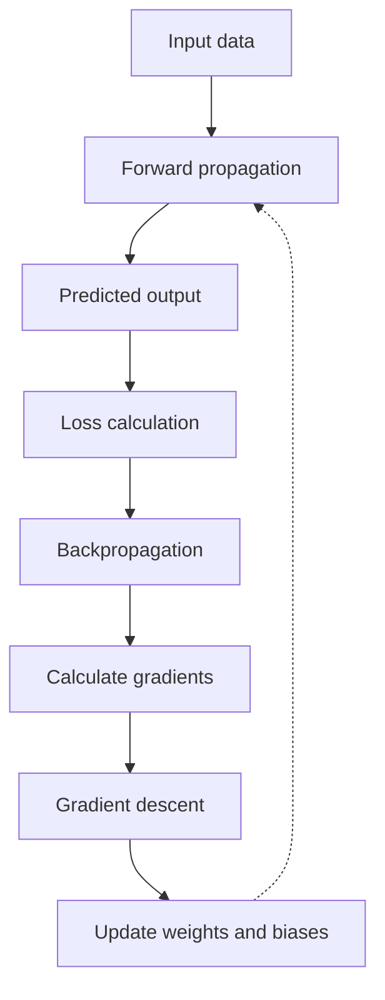
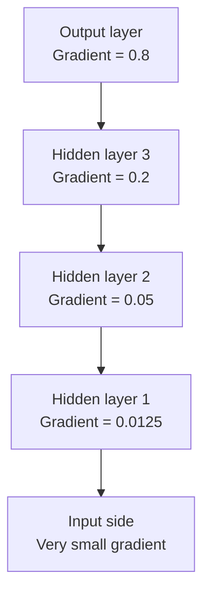
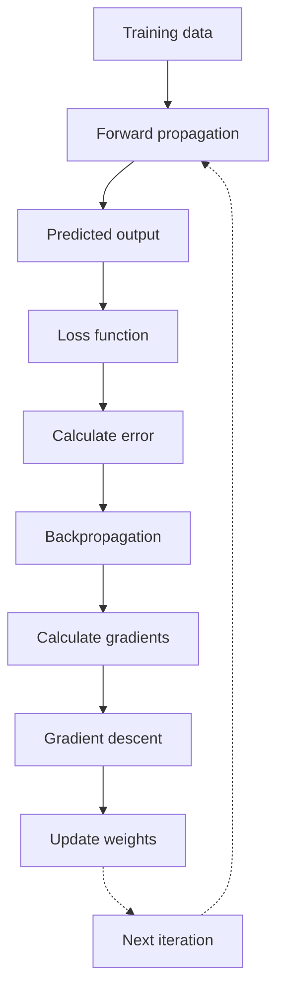

# Gradient Descent and Backpropagation in Deep Learning

Gradient Descent and Backpropagation are two important concepts used to train artificial neural networks (ANNs) and Multi-Layer Perceptrons (MLPs).

First, understand the difference:

- Backpropagation: Calculates how much each weight contributes to the prediction error.
- Gradient Descent: Uses those calculated gradients to update weights and reduce the error.

Both work together to train a neural network.

## 1. What is Gradient Descent?

Gradient Descent is an optimization algorithm used to minimize the loss function by continuously updating the weights and biases of a neural network.

In simple words, the model initially makes predictions with random or initialized weights. Gradient Descent helps the model adjust those weights so that its predictions become more accurate.

### How does Gradient Descent work?

Suppose we are training a model to predict house prices.

1. The model receives input data.
2. It predicts the house price.
3. We compare the predicted price with the actual price.
4. A loss function calculates the prediction error.
5. Gradient Descent updates the weights to reduce the error.
6. This process repeats until the model achieves a minimum loss or meets a stopping condition.

### Visual understanding

Imagine you are standing on a mountain and want to reach the lowest point in a valley.

- Your current position represents the current weights.
- The height represents the loss.
- The slope represents the gradient.
- Your step size represents the learning rate.
- Reaching the bottom represents minimizing the loss.

The algorithm takes steps in the opposite direction of the gradient because that is the direction of decreasing loss locally.

### Mathematical formula

$$
w_{\text{new}} = w_{\text{old}} - \alpha \frac{\partial L}{\partial w}
$$

Where:

- `w_new` = Updated weight
- `w_old` = Previous weight
- `α` = Learning rate
- `L` = Loss function
- `∂L/∂w` = Gradient of loss with respect to the weight

### Example

Suppose:

- Old weight = 5
- Learning rate = 0.1
- Gradient = 2

$$
w_{\text{new}} = 5 - (0.1 \times 2)
$$

$$
w_{\text{new}} = 4.8
$$

The weight changes from 5 to 4.8 to reduce the loss.

## 2. Types of Gradient Descent

There are three major types of Gradient Descent.

### A. Batch Gradient Descent

Batch Gradient Descent calculates the gradient using the entire training dataset before updating the weights.

How it works:

1. Takes the complete training dataset.
2. Calculates predictions for all training examples.
3. Calculates the total or average loss.
4. Computes the gradient.
5. Updates the weights once.

Example:

Suppose we have 1,000 training samples.

- All 1,000 samples are processed.
- One weight update is performed.

Advantages:

- Stable gradient updates.
- Generally smooth convergence.

Disadvantages:

- Slow for large datasets.
- Requires more memory.
- Does not update weights until the entire dataset is processed.

### B. Stochastic Gradient Descent (SGD)

Stochastic Gradient Descent updates the weights after processing each individual training example.

How it works:

1. Takes one training sample.
2. Predicts the output.
3. Calculates the loss.
4. Updates the weights.
5. Repeats for the next sample.

Example:

Suppose we have 1,000 training samples.

- Processes one sample.
- Updates weights.
- Repeats this process 1,000 times per epoch.

Advantages:

- Faster individual updates.
- Requires less memory.
- Can help escape shallow local minima due to noisy updates.

Disadvantages:

- Updates are noisy.
- Loss may fluctuate.
- Can take more steps to converge smoothly.

### C. Mini-Batch Gradient Descent

Mini-Batch Gradient Descent divides the complete training dataset into smaller batches and updates weights after processing each batch.

How it works:

1. Divides the dataset into small batches.
2. Processes one batch.
3. Calculates the average loss and gradient.
4. Updates weights.
5. Repeats for all batches.

Example:

Suppose we have 1,000 training samples and a batch size of 100.

- Total batches = 10.
- Processes 100 samples at a time.
- Updates weights 10 times per epoch.

Advantages:

- Faster and more memory-efficient than full-batch processing.
- More stable than pure SGD.
- Efficient for GPU processing.

Disadvantages:

- Batch size needs to be selected.
- Gradient updates can still contain some noise.

### Comparison of Gradient Descent types

| Feature           | Batch GD              | Stochastic GD    | Mini-Batch GD    |
| :---------------- | :-------------------- | :--------------- | :--------------- |
| Data per update   | Entire dataset        | One sample       | Small batch      |
| Updates per epoch | 1                     | N                | N / Batch size   |
| Speed             | Slower for large data | Frequent updates | Efficient        |
| Stability         | High                  | Low              | Moderate to high |
| Memory            | High                  | Low              | Moderate         |

> **Interview tip:** Mini-batch gradient descent is commonly used in deep learning because it balances computational efficiency and stable gradient updates.

## 3. What is Backpropagation?

Backpropagation is an algorithm used to calculate the gradients of the loss function with respect to the weights and biases of a neural network.

In simple words, it helps the neural network understand which weights are responsible for the prediction error and by how much they should change.

It uses the Chain Rule of Calculus to calculate gradients layer by layer, starting from the output layer and moving backwards.

### How does Backpropagation work?

Consider an MLP with one hidden layer.

The process involves the following steps:

### Step 1: Forward propagation

- Input data passes through the network.
- Every neuron calculates weighted sum and applies an activation function.
- The network produces a prediction.

### Step 2: Calculate loss

- Compare predicted output with actual output.
- Calculate the error using a loss function.

For example, Mean Squared Error:

$$
L = \frac{1}{n}\sum_{i=1}^{n}(y_i - \hat{y}_i)^2
$$

### Step 3: Backward propagation

- Start from the output layer.
- Calculate the gradients of the loss with respect to weights and biases.
- Use the chain rule to propagate gradients backwards through hidden layers.

### Step 4: Update weights

- Gradient Descent uses the calculated gradients.
- Updates weights and biases to minimize the loss.

### Step 5: Repeat

Repeat forward propagation and backpropagation over multiple training iterations.

## 4. Difference Between Backpropagation and Gradient Descent

| Feature      | Backpropagation            | Gradient Descent                    |
| ------------ | -------------------------- | ----------------------------------- |
| Purpose      | Calculates gradients       | Minimizes loss                      |
| Working      | Propagates error backwards | Updates weights                     |
| Main concept | Chain rule                 | Optimization                        |
| Output       | Gradients                  | Updated weights                     |
| Direction    | Output to input            | Uses gradients to update parameters |

Remember: Backpropagation calculates how the weights should change, and Gradient Descent actually updates those weights.

## 5. What is the Vanishing Gradient Problem?

The Vanishing Gradient Problem occurs when gradients become extremely small as they are propagated backwards through a deep neural network.

As a result, the weights in the earlier layers receive very small updates, making it difficult for the network to learn.

### Why does it happen?

During backpropagation, the chain rule multiplies derivatives of activation functions across multiple layers.

If these derivatives are consistently smaller than 1, their multiplication can become extremely small.

For example:

$$
0.25 \times 0.25 \times 0.25 \times 0.25
$$

$$
= 0.00390625
$$

As the number of layers increases, the gradient can become close to zero.

### Visual understanding

### Main causes of Vanishing Gradient

#### 1. Sigmoid activation function

The sigmoid function produces values between 0 and 1.

$$
\sigma(x) = \frac{1}{1 + e^{-x}}
$$

Its derivative is:

$$
\sigma'(x) = \sigma(x)(1 - \sigma(x))
$$

The maximum derivative is only 0.25.

Therefore, when many sigmoid derivatives are multiplied together, gradients can become very small.

#### 2. Tanh activation function

Tanh produces values between -1 and 1.

Its derivative is:

$$
\tanh'(x) = 1 - \tanh^2(x)
$$

Its derivative can also become very small when the input is highly positive or negative.

#### 3. Very deep networks

When the network contains many layers, repeated multiplication of small derivatives can make the gradients vanish.

### Effects of vanishing gradient

1. Earlier layers learn very slowly.
2. Weight updates become extremely small.
3. Training becomes difficult.
4. The network may fail to learn important features.
5. Overall model performance may decrease.

## 6. Solutions to the Vanishing Gradient Problem

There are several techniques to reduce or avoid this problem.

### 1. ReLU activation function

ReLU stands for Rectified Linear Unit.

It is defined as:

$$
\operatorname{ReLU}(x) = \max(0, x)
$$

Working:

- If input is positive, it returns the same input.
- If input is negative, it returns zero.

Its derivative is:

$$
\operatorname{ReLU}'(x) =
\begin{cases}
1, & x > 0 \\
0, & x < 0
\end{cases}
$$

Why does it help?

For positive inputs, the derivative is 1, so gradients do not continuously shrink due to the activation function.

Note: ReLU can cause the Dead ReLU problem when neurons remain inactive and produce zero gradients.

### 2. Leaky ReLU

Leaky ReLU is an improved version of ReLU.

It allows a small negative output instead of returning zero for all negative inputs.

$$
f(x) =
\begin{cases}
x, & x > 0 \\
0.01x, & x \leq 0
\end{cases}
$$

Why does it help?

It allows a small gradient for negative inputs, reducing the risk of neurons becoming permanently inactive.

### 3. Proper weight initialization

Weight initialization means assigning appropriate initial values to the weights before training.

Two important methods are:

- Xavier Initialization: Commonly used with Sigmoid and Tanh activations.
- He Initialization: Commonly used with ReLU and its variants.

Why does it help?

It helps maintain reasonable activation and gradient magnitudes across layers during training.

### 4. Batch normalization

Batch Normalization normalizes the activations of a layer using the mean and variance of a mini-batch.

$$
\hat{x} = \frac{x - \mu}{\sqrt{\sigma^2 + \epsilon}}
$$

It then applies learnable scale and shift parameters.

Why does it help?

It helps maintain more stable activation distributions and can improve training stability. It does not guarantee that vanishing gradients will disappear.

### 5. Residual connections (ResNet)

Residual connections provide a shortcut path that allows information and gradients to bypass some layers.

The residual block can be represented as:

$$
\operatorname{Output} = F(x) + x
$$

Where:

- x = Original input.
- F(x) = Output of the layers in the block.

Why does it help?

The shortcut connection provides an additional path for gradients to flow backwards, making it easier to train very deep networks.

### 6. LSTM and GRU

LSTM (Long Short-Term Memory) and GRU (Gated Recurrent Unit) are special types of recurrent neural networks.

They use gates to control how information is retained, updated, and forgotten.

Why do they help?

They provide mechanisms that help preserve information and gradients over longer sequences, reducing the vanishing gradient problem in recurrent networks.

## 7. Vanishing Gradient vs Exploding Gradient

Both problems occur during backpropagation.

| Feature        | Vanishing Gradient                                | Exploding Gradient                                      |
| -------------- | ------------------------------------------------- | ------------------------------------------------------- |
| Meaning        | Gradients become extremely small                  | Gradients become extremely large                        |
| Weight updates | Very small                                        | Very large                                              |
| Training       | Very slow or stops learning                       | Unstable training                                       |
| Main reason    | Repeated multiplication of small derivatives      | Repeated multiplication of large derivatives            |
| Solutions      | ReLU, proper initialization, residual connections | Gradient clipping, proper initialization, normalization |

### What is Gradient Clipping?

Gradient clipping is a technique used to prevent gradients from becoming excessively large.

If the gradient norm exceeds a predefined threshold, it is scaled down.

It is mainly used to address the exploding gradient problem.

## 8. Complete Training Process: How Everything Works Together

This is the most important flow to remember for interviews.

## 9. Important Interview Questions

### Q1. What is gradient descent?

Gradient Descent is an optimization algorithm that updates model weights in the opposite direction of the gradient to minimize the loss function.

### Q2. What is backpropagation?

Backpropagation is an algorithm that calculates gradients of the loss with respect to weights and biases using the chain rule.

### Q3. What is the difference between an epoch, batch, and iteration?

- Epoch: One complete pass through the entire training dataset.
- Batch: A subset of training data processed together.
- Iteration: One weight update.

### Q4. Which gradient descent is commonly used in deep learning?

Mini-Batch Gradient Descent is commonly used because it provides a good balance between computational efficiency and stable updates.

### Q5. What happens if the learning rate is too high?

The model may overshoot the minimum point, causing unstable training or failure to converge.

### Q6. What happens if the learning rate is too low?

Training becomes very slow because weights are updated by very small amounts.

### Q7. Why is ReLU preferred over sigmoid in hidden layers?

ReLU is computationally simple and maintains a derivative of 1 for positive inputs, helping reduce the vanishing gradient problem.

### Q8. What is the chain rule?

The Chain Rule is a mathematical rule used to calculate the derivative of a composite function. Backpropagation uses it to calculate gradients across multiple layers.

### Q9. How can we solve the vanishing gradient problem?

We can reduce it using ReLU or its variants, proper weight initialization, Batch Normalization, residual connections, and architectures such as LSTM and GRU for sequential data.

## 10. Quick Revision for Interviews

| Concept               | Remember this                         |
| --------------------- | ------------------------------------- |
| Gradient Descent      | Updates weights to minimize loss      |
| Backpropagation       | Calculates gradients using chain rule |
| Batch GD              | Uses entire dataset for one update    |
| SGD                   | Uses one sample for one update        |
| Mini-Batch GD         | Uses a small batch for one update     |
| Learning Rate         | Controls the size of weight updates   |
| Vanishing Gradient    | Gradients become too small            |
| Exploding Gradient    | Gradients become too large            |
| ReLU                  | Helps reduce vanishing gradients      |
| He Initialization     | Commonly used with ReLU               |
| Xavier Initialization | Commonly used with Sigmoid/Tanh       |
| Residual Connection   | Provides shortcut paths for gradients |
| Gradient Clipping     | Controls exploding gradients          |

Most important thing to remember:

- Backpropagation = Calculates the gradients.
- Gradient Descent = Updates the weights.
- Vanishing Gradient = Earlier layers learn very slowly because gradients become too small.
- ReLU, proper initialization, and residual connections = Important techniques to reduce vanishing gradients.