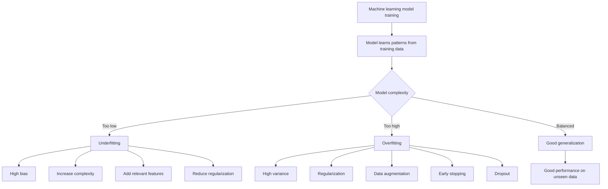

# Overfitting, Underfitting, Bias-Variance Tradeoff and Regularization Techniques in Machine Learning / Deep Learning

These concepts are closely related. They explain why a machine learning model performs poorly, why it sometimes performs well on training data but poorly on new data, and how we can prevent this problem.

Let's understand them in a proper hierarchical order.

# 1. Understanding Model Fitting

Before understanding overfitting and underfitting, we need to understand how a machine learning model learns.

When we train a model, we generally divide our dataset into:

1. Training Dataset: Used to train the model and learn patterns.
2. Validation Dataset: Used to evaluate the model during training and tune hyperparameters.
3. Testing Dataset: Used to evaluate the final model on unseen data.

The main objective is not just to perform well on training data. The objective is to perform well on unseen data.

This ability is called generalization.


[prof-frenzel.medium.com](https://prof-frenzel.medium.com/kb-resampling-methods-part-1-51b3d117b58b?utm_source=chatgpt.com)

For example:

Suppose we train a model to identify cats and dogs.

- Training accuracy = 99%
- Testing accuracy = 65%

Although the model performs very well on training data, it performs poorly on new images.

This indicates that the model has not learned general patterns properly.

This brings us to overfitting and underfitting.

# 2. Overfitting

## 2.1 What is Overfitting?

Overfitting occurs when a machine learning model learns the training data too well, including noise, unnecessary details, and random patterns, instead of learning the actual underlying relationship.

As a result:

- Training accuracy is very high.
- Testing accuracy is low.
- Training loss is very low.
- Testing loss is high.

In simple words, the model memorizes the training data instead of learning general patterns.

## 2.2 Example of Overfitting

Suppose we want to predict house prices based on house size.

Our training dataset contains:

| House size (sq. ft.) | Price (₹ lakh) |
| -------------------- | -------------- |
| 500                  | 25             |
| 700                  | 35             |
| 900                  | 45             |
| 1100                 | 55             |
| 1300                 | 65             |

The actual relationship is approximately linear.

However, imagine that our model learns every individual training point using a very complex curve.

It may achieve almost zero training error, but when we provide a new house size, such as 1000 sq. ft., its prediction may be inaccurate.

The model has learned unnecessary fluctuations instead of the actual relationship.

## 2.3 Graphical Representation


[linkedin.com](https://www.linkedin.com/pulse/comprehensive-guide-stratified-k-fold-unbalanced-data-juan-carlos-n6aee?utm_source=chatgpt.com)

- Underfitting: Model is too simple to capture the relationship.
- Good fitting: Model captures the underlying relationship.
- Overfitting: Model captures the training points and noise.

## 2.4 Causes of Overfitting

1. Complex Model: Using a model with too many parameters.
2. Small Dataset: Insufficient training examples.
3. Noisy Data: Model learns unnecessary patterns and noise.
4. Too Many Training Epochs: Model continues learning training-specific details.
5. Insufficient Regularization: No mechanism to control model complexity.

## 2.5 How to Prevent Overfitting?

We use several techniques:

- Regularization (L1 and L2)
- Data Augmentation
- Early Stopping
- Dropout
- Cross-validation
- Increasing training data
- Reducing model complexity

We will understand each technique in detail below.

# 3. Underfitting

## 3.1 What is Underfitting?

Underfitting occurs when a machine learning model is too simple to learn the underlying patterns and relationships present in the training data.

The model fails to learn even the training data properly.

As a result:

- Training accuracy is low.
- Testing accuracy is also low.
- Training loss is high.
- Testing loss is high.

In simple words, the model has not learned enough from the data.

## 3.2 Example of Underfitting

Suppose we want to predict house prices based on house size.

The actual relationship between house size and price might be complex.

However, we use a very simple model that always predicts the same price.

For example:

- 500 sq. ft. → ₹40 lakh
- 1000 sq. ft. → ₹40 lakh
- 1500 sq. ft. → ₹40 lakh

The model is too simple to understand how house size affects price.

Therefore, it performs poorly on both training and testing datasets.

## 3.3 Causes of Underfitting

1. Simple Model: Model is not complex enough to capture the patterns.
2. Insufficient Training: Model has not learned enough.
3. Excessive Regularization: Too much regularization restricts learning.
4. Poor Feature Selection: Important features are missing.
5. Insufficient Training Time: Model stops before learning useful patterns.

## 3.4 How to Prevent Underfitting?

- Increase model complexity.
- Add relevant features.
- Reduce regularization strength.
- Train for more epochs.
- Use better model architectures.
- Improve feature engineering.

# 4. Difference Between Overfitting and Underfitting

| Parameter         | Overfitting                   | Underfitting                       |
| ----------------- | ----------------------------- | ---------------------------------- |
| Meaning           | Learns training data too well | Fails to learn underlying patterns |
| Model complexity  | Too high                      | Too low                            |
| Training accuracy | Very high                     | Low                                |
| Testing accuracy  | Low                           | Low                                |
| Training loss     | Very low                      | High                               |
| Testing loss      | High                          | High                               |
| Main problem      | Poor generalization           | Insufficient learning              |
| Solution          | Regularization, dropout, etc. | Increase model complexity          |

## 4.1 Comparison of Three Models


[cvw.cac.cornell.edu](https://cvw.cac.cornell.edu/SciML/mlp/universal-approximation-width-practicalities?utm_source=chatgpt.com)

The ideal model should learn the important patterns without memorizing unnecessary details.

# 5. Bias-Variance Tradeoff

This is one of the most important concepts in machine learning.

To understand it, first understand bias and variance separately.

## 5.1 Bias

Bias is the error introduced when a model makes overly simplistic assumptions about the underlying data.

In simple words, bias tells us how far the model's average predictions are from the actual values because of its assumptions.

Example:

Suppose the actual relationship between house size and price is nonlinear.

But we use a simple linear regression model.

The model cannot capture the actual relationship properly.

Therefore, it makes systematic errors.

This is called High Bias.

Characteristics of high bias:

- Model is too simple.
- Does not capture important patterns.
- Training error is high.
- Usually leads to underfitting.

## 5.2 Variance

Variance measures how much a model's predictions change when it is trained on different training datasets.

In simple words, variance tells us how sensitive the model is to changes in training data.

Example:

Suppose we train a highly complex decision tree on three slightly different datasets.

- Model 1 learns one set of patterns.
- Model 2 learns significantly different patterns.
- Model 3 also produces different predictions.

This means the model is highly sensitive to the training data.

This is called High Variance.

Characteristics of high variance:

- Model is too complex.
- Learns noise and unnecessary patterns.
- Training error is low.
- Testing error is high.
- Usually leads to overfitting.

## 5.3 Bias vs Variance

| High Bias               | High Variance         |
| ----------------------- | --------------------- |
| Model is too simple     | Model is too complex  |
| Underfitting            | Overfitting           |
| Fails to learn patterns | Learns noise          |
| Training error is high  | Training error is low |
| Testing error is high   | Testing error is high |

## 5.4 Bias-Variance Tradeoff

The Bias-Variance Tradeoff means balancing bias and variance to achieve good generalization on unseen data.

When we increase model complexity:

- Bias generally decreases.
- Variance generally increases.

When we decrease model complexity:

- Bias generally increases.
- Variance generally decreases.

Our objective is to find an appropriate balance.


[medium.com](https://medium.com/%40shivamsde945/bias-variance-tradeoff-explained-with-e-commerce-examples-7092e80de4f8?utm_source=chatgpt.com)

### Bias-Variance Decomposition

For a regression problem with squared error, expected prediction error can be decomposed as:

$$
\text{Expected Error} = \text{Bias}^2 + \text{Variance} + \text{Noise}
$$

Where:

- Bias²: Error due to incorrect assumptions.
- Variance: Error due to sensitivity to training data.
- Noise: Random error that cannot be eliminated by the model.

The goal is to minimize the total expected prediction error.

### Important Interview Point

- High Bias → Underfitting.
- High Variance → Overfitting.
- Balanced Bias and Variance → Good Generalization.

# 6. Regularization

## 6.1 What is Regularization?

Regularization is a technique used to prevent overfitting by adding a penalty to the model's loss function, discouraging unnecessarily complex models.

In simple words, regularization prevents the model from assigning excessively large importance to features or learning unnecessarily complex patterns.

It encourages the model to learn simpler and more general patterns.

## 6.2 Why Do We Need Regularization?

Consider a model that predicts house prices.

Suppose it learns the following weights:

$$
\text{Price} = 10 + 1000X_1 + 9000X_2
$$

Here, the model may be giving an unnecessarily large weight to one feature.

This can make the model sensitive to small changes in the training data.

Regularization adds a penalty for large weights.

The model tries to minimize both:

1. Prediction error.
2. Model complexity penalty.

There are two commonly used regularization techniques.

## 6.3 L1 Regularization (Lasso)

L1 Regularization adds the absolute values of model weights to the original loss function as a penalty.

Formula:

$$
L_{\text{total}} = L_{\text{original}} + \lambda \sum_{i=1}^{n} |w_i|
$$

Where:

- $L_{\text{original}}$ = Original loss function.
- $w_i$ = Model weights.
- $\lambda$ = Regularization strength.

### How does it work?

Suppose we have five features:

$$
w = [2, 5, 8, 1, 7]
$$

L1 regularization penalizes the sum of absolute weights.

It can push some weights exactly to zero.

For example:

$$
w = [2, 5, 0, 0, 7]
$$

This means some features are effectively removed from the model.

### Important points

- Can make some weights exactly zero.
- Performs feature selection.
- Useful when many features are irrelevant.
- Produces sparse models.

## 6.4 L2 Regularization (Ridge)

L2 Regularization adds the squared values of model weights to the original loss function as a penalty.

Formula:

$$
L_{\text{total}} = L_{\text{original}} + \lambda \sum_{i=1}^{n} w_i^2
$$

### How does it work?

Suppose the model has these weights:

$$
w = [2, 5, 8, 1, 7]
$$

L2 regularization penalizes large squared weights.

It tries to reduce the weights:

$$
w = [1.5, 3.5, 5.2, 0.8, 4.1]
$$

The exact values depend on the data and optimization.

Unlike L1, L2 generally does not make weights exactly zero.

### Important points

- Reduces large weights.
- Makes the model less sensitive to individual features.
- Helps prevent overfitting.
- Generally retains all features.

## 6.5 L1 vs L2 Regularization

| L1 (Lasso)                 | L2 (Ridge)                           |
| -------------------------- | ------------------------------------ |
| Uses absolute weights      | Uses squared weights                 |
| $\sum \lvert w_i \rvert$   | $\sum w_i^2$                         |
| Can make weights zero      | Usually makes weights small          |
| Performs feature selection | Retains most features                |
| Produces sparse models     | Produces smaller distributed weights |


[stanford-mse-125.github.io](https://stanford-mse-125.github.io/slides/lec06-validation.html?utm_source=chatgpt.com)

## 6.6 What is Lambda (λ)?

Lambda controls the strength of regularization.

- Small λ → Less penalty → Model can become complex.
- Large λ → More penalty → Model becomes simpler.

If lambda is too large, the model may become too simple and underfit.

If lambda is too small, the model may still overfit.

Therefore, we need to select an appropriate lambda using validation data or cross-validation.

# 7. Data Augmentation

## 7.1 What is Data Augmentation?

Data augmentation is a technique used to increase the diversity of training data by creating modified versions of existing data.

It is commonly used in deep learning, especially in computer vision.

In simple words, instead of collecting thousands of new images, we create variations of existing images.

This helps the model learn more general patterns and reduces overfitting.

## 7.2 Example

Suppose we have only 100 images of cats.

We can create modified versions of those images using:

1. Rotation.
2. Flipping.
3. Zooming.
4. Cropping.
5. Changing brightness.
6. Adding noise.

Now, the model sees many different variations of cats.


## 7.3 Types of Data Augmentation

### A. Image Augmentation

Used in computer vision.

- Rotation: Rotates the image.
- Flipping: Creates horizontal or vertical flips.
- Cropping: Selects a portion of an image.
- Zooming: Enlarges or reduces the image.
- Brightness adjustment: Changes image brightness.
- Translation: Moves the image horizontally or vertically.

### B. Text Augmentation

Used in Natural Language Processing (NLP).

Examples:

Original sentence:

"I like machine learning."

Possible variations:

- "I enjoy machine learning."
- "Machine learning is something I like."

Techniques include:

- Synonym replacement.
- Random word deletion.
- Random word insertion.
- Back translation.

### C. Audio Augmentation

Used in speech recognition and audio classification.

Examples:

- Adding background noise.
- Changing speed.
- Changing pitch.
- Time shifting.

## 7.4 How Does Data Augmentation Prevent Overfitting?

Suppose a model is trained only on images of cats facing left.

It may learn that cats usually face left.

When it receives an image of a cat facing right, it may fail.

By using flipping and rotation, the model sees different variations.

Therefore, it learns important features such as:

- Eyes.
- Ears.
- Body shape.
- Facial structure.

Instead of memorizing the exact image orientation.

## 7.5 Advantages and Limitations

Advantages:

- Increases training data diversity.
- Reduces overfitting.
- Improves generalization.
- Useful when collecting new data is expensive.

Limitations:

- Augmentation must preserve the correct label.
- Excessive transformation can produce unrealistic examples.
- Does not automatically fix poor-quality or biased datasets.

# 8. Early Stopping

## 8.1 What is Early Stopping?

Early stopping is a regularization technique that stops model training when the validation performance stops improving.

In simple words, we do not allow the model to train unnecessarily for too many epochs.

This prevents the model from learning noise and unnecessary details from training data.

## 8.2 Understanding Epoch

An epoch means one complete pass through the entire training dataset.

For example:

If we have 1,000 training images:

- Epoch 1: Model processes all 1,000 images.
- Epoch 2: Model processes all 1,000 images again.
- Epoch 3: Model processes all 1,000 images again.

And so on.

## 8.3 How Does Early Stopping Work?

During training, we monitor two things:

1. Training loss.
2. Validation loss.

Initially, both training loss and validation loss usually decrease.

However, after some epochs:

- Training loss continues decreasing.
- Validation loss starts increasing.

This indicates that the model is starting to overfit.

Therefore, we stop training at the point where validation performance is best.


[nkfreeman-teaching.github.io](https://nkfreeman-teaching.github.io/BAN-501-course-companion/appendices/surprising-phenomena/?utm_source=chatgpt.com)

### Example

Suppose we get the following results:

| Epoch | Training Loss | Validation Loss |
| ----- | ------------- | --------------- |
| 1     | 0.80          | 0.85            |
| 2     | 0.60          | 0.65            |
| 3     | 0.40          | 0.50            |
| 4     | 0.25          | 0.35            |
| 5     | 0.15          | 0.30            |
| 6     | 0.08          | 0.38            |
| 7     | 0.04          | 0.48            |
| 8     | 0.01          | 0.60            |

Notice:

- Training loss keeps decreasing.
- Validation loss decreases until epoch 5.
- After epoch 5, validation loss starts increasing.

Therefore, the best model is at epoch 5.

We should stop training and restore the model weights from epoch 5.

## 8.4 What is Patience in Early Stopping?

Patience is the number of consecutive epochs we allow without improvement before stopping training.

For example:

If patience = 3:

- Epoch 6: No improvement.
- Epoch 7: No improvement.
- Epoch 8: No improvement.

Training stops after three consecutive epochs without improvement.

This prevents stopping due to small fluctuations in validation loss.

## 8.5 Advantages

- Prevents overfitting.
- Saves training time.
- Does not require changing the model architecture.
- Helps select the best training epoch.

# 9. Dropout

## 9.1 What is Dropout?

Dropout is a regularization technique used in neural networks in which randomly selected neurons are temporarily deactivated during each training iteration.

In simple words, dropout randomly switches off some neurons during training so that the network does not become overly dependent on particular neurons.

It helps prevent overfitting.

## 9.2 Why Do We Need Dropout?

Consider a neural network with 100 neurons in a hidden layer.

Suppose some neurons become highly dependent on each other.

The network may learn specific patterns that work only on training data.

This can lead to overfitting.

Dropout randomly disables some neurons during training.

As a result:

- The network cannot depend on specific neurons.
- Different neurons learn useful features.
- The network becomes more robust.
- Generalization improves.

## 9.3 How Does Dropout Work?

Suppose we have a neural network with 10 neurons in a hidden layer.

We apply a dropout rate of 0.3.

This means approximately 30% of the neurons are randomly deactivated during each training iteration.


[carpentries-incubator.github.io](https://carpentries-incubator.github.io/intro-image-classification-cnn/instructor/aio.html?utm_source=chatgpt.com)

Example:

Original neurons:

$$
[N_1, N_2, N_3, N_4, N_5, N_6, N_7, N_8, N_9, N_{10}]
$$

After applying dropout in one iteration:

$$
[N_1, 0, N_3, N_4, 0, N_6, N_7, 0, N_9, N_{10}]
$$

Here, neurons 2, 5 and 8 are temporarily deactivated.

In the next iteration, a different set of neurons may be deactivated.

Important: Dropout is applied during training, not during normal inference/testing. During inference, all neurons are active, with the appropriate scaling handled by the implementation.

## 9.4 What is Dropout Rate?

Dropout rate represents the probability of deactivating a neuron.

| Dropout Rate | Meaning             |
| ------------ | ------------------- |
| 0.1          | 10% neurons dropped |
| 0.2          | 20% neurons dropped |
| 0.3          | 30% neurons dropped |
| 0.5          | 50% neurons dropped |

For example:

If dropout = 0.5, approximately half the neurons are temporarily deactivated during each training iteration.

A very high dropout rate can cause underfitting.

## 9.5 Dropout in Python (TensorFlow/Keras)

```python
from tensorflow.keras.layers import Dense, Dropout
from tensorflow.keras.models import Sequential

model = Sequential(
    [
        Dense(128, activation="relu", input_shape=(20,)),
        Dropout(0.3),
        Dense(64, activation="relu"),
        Dropout(0.2),
        Dense(1, activation="sigmoid"),
    ]
)
```

Here:

- First hidden layer has 128 neurons.
- Dropout 0.3 randomly disables 30% of its neurons during training.
- Second hidden layer has 64 neurons.
- Dropout 0.2 randomly disables 20% of its neurons during training.

# 10. Comparison of Overfitting Prevention Techniques

Now let's compare all the techniques we have studied.

| Technique         | How it works                                      | Main purpose                |
| ----------------- | ------------------------------------------------- | --------------------------- |
| L1 Regularization | Adds absolute weight penalty                      | Feature selection           |
| L2 Regularization | Adds squared weight penalty                       | Reduces large weights       |
| Data Augmentation | Creates modified training samples                 | Increases data diversity    |
| Early Stopping    | Stops when validation performance stops improving | Prevents excessive training |
| Dropout           | Randomly deactivates neurons                      | Prevents neuron dependency  |

## 10.1 Which Technique Should We Use?

It depends on the problem.

- L1: When we have many irrelevant features.
- L2: When we want to reduce large model weights.
- Data Augmentation: When we have limited training data, particularly images, text or audio.
- Early Stopping: When the model starts overfitting after several epochs.
- Dropout: When a neural network has high variance and overfits.

These techniques can also be combined.

For example, a deep learning image classification model can use:

- Data augmentation to increase training data diversity.
- Dropout to reduce neuron dependency.
- L2 regularization to control weights.
- Early stopping to stop training at the right time.

# 11. Complete Relationship Between All Concepts

This is the most important flow to understand for exams and interviews.



# 12. Important Interview Questions and Answers

Q1. What is the difference between overfitting and underfitting?

Overfitting occurs when a model learns training data too well, including noise, whereas underfitting occurs when a model is too simple to learn the underlying patterns.

Q2. What is the bias-variance tradeoff?

It is the process of balancing bias and variance to minimize prediction error and achieve good generalization.

Q3. How does regularization prevent overfitting?

Regularization adds a penalty to the loss function to discourage unnecessarily large weights and complex models.

Q4. What is the difference between L1 and L2 regularization?

L1 can make some weights exactly zero and perform feature selection, whereas L2 reduces the magnitude of weights without generally making them exactly zero.

Q5. What is data augmentation?

It increases training data diversity by creating modified versions of existing samples, such as rotating, flipping and cropping images.

Q6. What is early stopping?

It stops model training when validation performance stops improving to prevent overfitting.

Q7. What is dropout?

Dropout randomly deactivates a percentage of neurons during training to prevent the network from becoming dependent on particular neurons.

Q8. Is dropout applied during testing?

No. During inference, all neurons are active. Dropout is used during training.

Q9. Can regularization cause underfitting?

Yes. Excessively strong regularization can make the model too simple, resulting in underfitting.

Q10. Can we use dropout and L2 regularization together?

Yes. Both can be used together to reduce overfitting in neural networks.

## 13. Quick Revision Sheet

| Concept                | Remember this                                 |
| ---------------------- | --------------------------------------------- |
| Overfitting            | Memorization of training data                 |
| Underfitting           | Model fails to learn patterns                 |
| Bias                   | Error due to simplistic assumptions           |
| Variance               | Sensitivity to training data changes          |
| Bias-Variance Tradeoff | Balance between bias and variance             |
| Regularization         | Penalty on model complexity                   |
| L1                     | Can make weights zero                         |
| L2                     | Reduces large weights                         |
| Data Augmentation      | Creates variations of training data           |
| Early Stopping         | Stops training at the right time              |
| Dropout                | Randomly switches off neurons during training |

My recommendation for studying these topics: Understand the relationship between overfitting, underfitting and bias-variance first. Then learn regularization, data augmentation, early stopping and dropout as solutions to overfitting. This sequence will also help you explain the concepts logically in an ML/DL interview.
