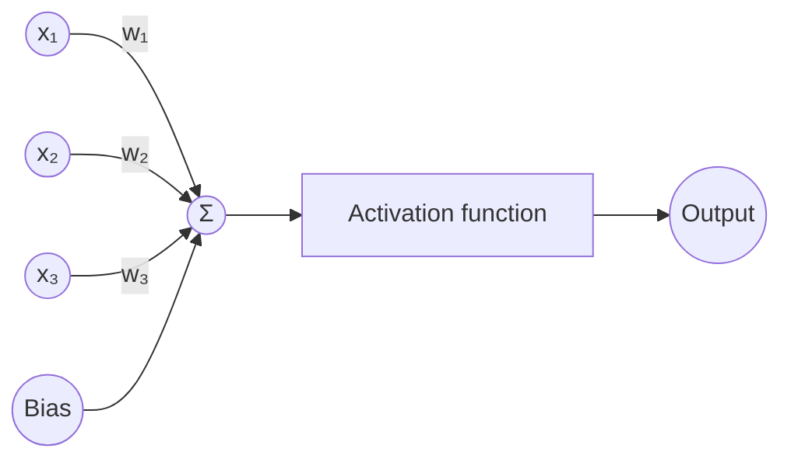
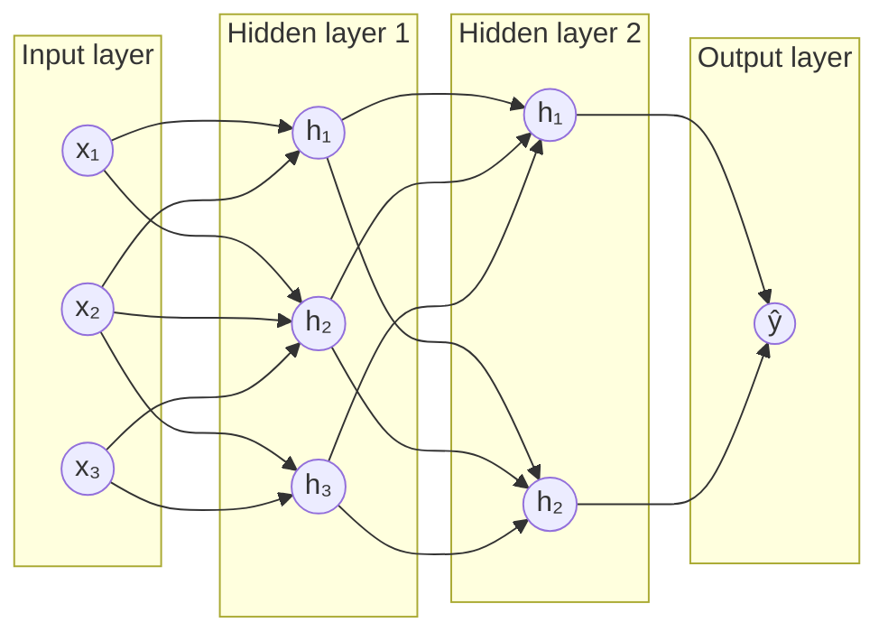
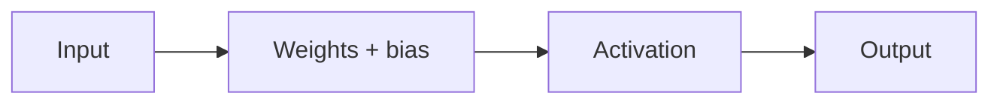
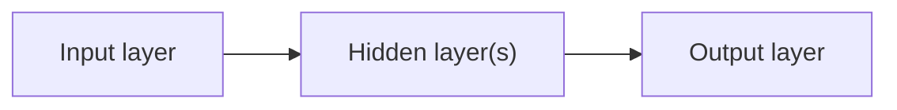

# Perceptron and Multi-Layer Perceptron (MLP)

Perceptrons and multi-layer perceptrons (MLPs) are fundamental building blocks for understanding artificial neural networks.

This guide explains their architecture, working principles, differences, and limitations.

## 1. Perceptron

A perceptron is the simplest form of an artificial neural network (ANN). It is a single artificial neuron that takes multiple inputs, applies weights and a bias, and produces an output.

It is mainly used for binary classification problems.

### Architecture of a Perceptron

### How does a Perceptron work?

A perceptron works in four steps:

1. **Input:** Takes input values such as `x₁`, `x₂`, and `x₃`.
2. **Weights:** Multiplies each input by a weight representing its importance.
3. **Summation:** Adds all weighted inputs and the bias.
4. **Activation function:** Converts the calculated value into the final output.

### Mathematical Formula

First, calculate the weighted sum:

$$
z = \sum_{i=1}^{n} w_i x_i + b
$$

Then apply the activation function:

$$
y = f(z)
$$

Where:

- `xᵢ` = Input values
- `wᵢ` = Weights
- `b` = Bias
- `f` = Activation function
- `y` = Predicted output

For example, using a step activation function:

$$
f(z) =
\begin{cases}
1, & z \geq 0 \\
0, & z < 0
\end{cases}
$$

### Example

Suppose we want to predict whether a student passes or fails based on study hours:

- Input: `5` hours
- Weight: `2`
- Bias: `-5`

$$
z = (5 \times 2) - 5 = 5
$$

Since `z` is greater than or equal to `0`, the output is `1` (Pass).

## 2. Multi-Layer Perceptron (MLP)

An MLP is a feedforward artificial neural network containing an input layer, one or more hidden layers, and an output layer. The hidden layers allow it to learn complex patterns and relationships from data.

Unlike a single perceptron, an MLP contains hidden layers and uses nonlinear activation functions.

### Architecture of MLP

### Mathematical Formula

For an MLP, each layer calculates a weighted sum, adds a bias, and applies an activation function:

$$
\mathbf{a}^{(l)} =
f^{(l)}\left(\mathbf{W}^{(l)}\mathbf{a}^{(l-1)}
+ \mathbf{b}^{(l)}\right)
$$

For a network with one hidden layer:

$$
\mathbf{z}^{(1)} = \mathbf{W}^{(1)}\mathbf{x} + \mathbf{b}^{(1)}
$$

$$
\mathbf{h} = f\left(\mathbf{z}^{(1)}\right)
$$

$$
\mathbf{z}^{(2)} = \mathbf{W}^{(2)}\mathbf{h} + \mathbf{b}^{(2)}
$$

$$
\hat{\mathbf{y}} = g\left(\mathbf{z}^{(2)}\right)
$$

Where:

- `x` = Input vector
- `W⁽ˡ⁾` = Weight matrix for layer `l`
- `b⁽ˡ⁾` = Bias vector for layer `l`
- `h` = Hidden-layer output
- `f` = Hidden-layer activation function, such as ReLU
- `g` = Output-layer activation function
- `ŷ` = Predicted output

MLP consists of three main types of layers:

### Input layer

- Receives input data.
- Each neuron represents one input feature.
- Examples: age, salary, and experience.

### Hidden layer

- Performs mathematical calculations using weights and biases.
- Applies activation functions.
- Learns complex patterns from input data.
- An MLP can have one or multiple hidden layers.

### Output layer

- Produces the final prediction.
- Examples: Pass/Fail and Spam/Not Spam.

### How does MLP work?

1. Input data is passed to the input layer.
2. Each neuron calculates the weighted sum of inputs and bias.
3. An activation function is applied.
4. The output is passed to the next layer. This is called Forward Propagation.
5. The predicted output is compared with the actual output using a loss function.
6. The error is propagated backwards to update weights. This is called Backpropagation.
7. This process repeats until the model learns suitable weights.

## 3. Perceptron vs MLP

| Feature       | Perceptron                   | MLP                                                    |
| :------------ | :--------------------------- | :----------------------------------------------------- |
| Layers        | One computational layer      | Multiple layers                                        |
| Hidden layers | No                           | Yes                                                    |
| Complexity    | Simple                       | More complex                                           |
| Activation    | Usually a step function      | ReLU, sigmoid, or tanh                                 |
| Learning      | Perceptron learning rule     | Backpropagation                                        |
| Problems      | Linearly separable           | Linear and nonlinear patterns                          |
| Applications  | Simple binary classification | Image classification, prediction, and pattern matching |

## 4. Why do we need MLP instead of a single Perceptron?

The biggest limitation of a single perceptron is that it can only solve linearly separable problems.

For example, consider the XOR problem:

| Input A | Input B | Output |
| ------- | ------- | ------ |
| 0       | 0       | 0      |
| 0       | 1       | 1      |
| 1       | 0       | 1      |
| 1       | 1       | 0      |

A single perceptron cannot correctly classify all these combinations because the XOR outputs are not linearly separable.

An MLP with at least one suitable hidden layer and nonlinear activation functions can solve the XOR problem.

### Why does MLP solve XOR?

Because hidden layers and nonlinear activation functions allow the network to learn complex decision boundaries instead of just a straight line.

## 5. Important Interview Questions

### Q1. What is the difference between a neuron and a perceptron?

A neuron is a basic computational unit of a neural network, whereas a perceptron is a specific type of artificial neuron that typically uses a step activation function.

### Q2. What is the role of weights and bias?

- Weights determine the importance of each input.
- Bias helps shift the activation function and allows the neuron to learn more flexible decision boundaries.

### Q3. Why do we use activation functions?

Activation functions introduce non-linearity into neural networks. Without nonlinear activation functions, even multiple layers would behave like a single linear transformation.

### Q4. What is backpropagation?

Backpropagation is an algorithm that calculates how much each weight contributes to the prediction error and helps update weights to minimize the error.

### Q5. Is MLP a deep learning model?

Yes. MLP is a type of feedforward artificial neural network. When it has multiple hidden layers, it is considered a deep neural network.

## 6. Quick Revision

### Perceptron

Single artificial neuron:

### MLP

Multiple interconnected neurons and layers:

### Remember these three terms

- Forward Propagation: Pass input through the network to predict output.
- Loss Function: Calculate prediction error.
- Backpropagation: Calculate gradients and update weights to reduce error.

### Interview-ready definition

A perceptron is a single artificial neuron used for simple classification, whereas MLP is a network of interconnected neurons with one or more hidden layers that can learn complex nonlinear relationships using forward propagation and backpropagation.