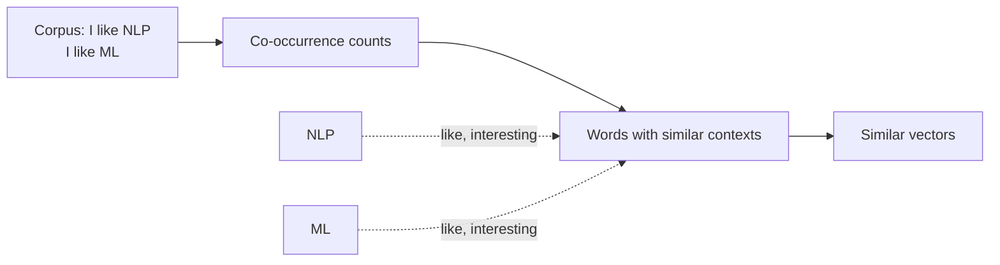
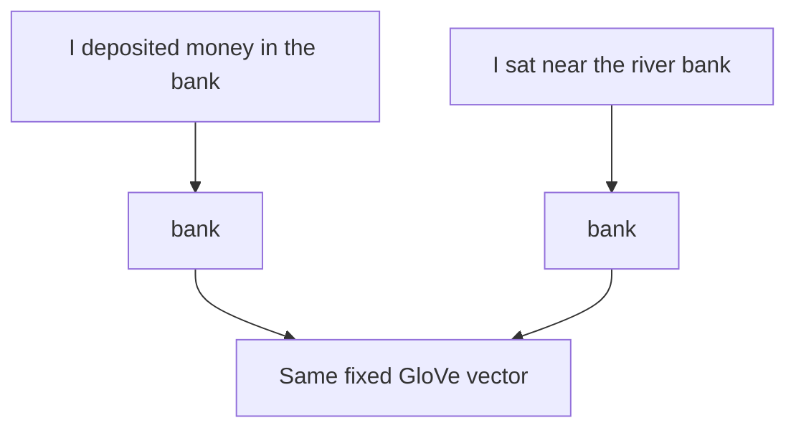
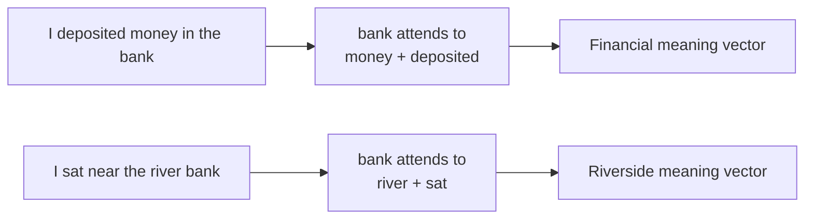
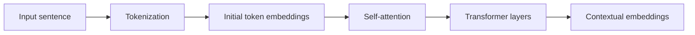
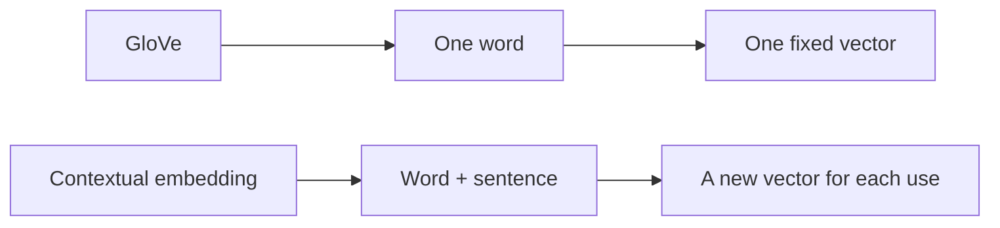

# GloVe and Contextual Embeddings

## 1. GloVe (Global Vectors for Word Representation)

GloVe is an unsupervised word-embedding algorithm. It learns dense vectors by
using global word co-occurrence statistics from a corpus.

In simple terms, GloVe learns a word's meaning by observing how frequently it
appears near other words.

### 1.1 Why do we need GloVe?

Consider these sentences:

1. I like eating apples.
2. Apples are healthy fruits.
3. I like eating bananas.
4. Bananas are healthy fruits.

From these sentences:

- Apple frequently appears with *eating* and *fruits*.
- Banana frequently appears with *eating* and *fruits*.
- Apple and banana therefore have similar contexts.

GloVe uses these relationships to learn similar vector representations for
similar words.

### 1.2 How does GloVe work?

GloVe primarily uses a **word co-occurrence matrix**. This matrix records how
often two words occur together within a specified context window.

Suppose the corpus contains:

- I like NLP
- I like ML
- NLP is interesting
- ML is interesting

A simplified co-occurrence matrix is:

| Word        | I | like | NLP | ML | interesting |
|-------------|---:|-----:|----:|---:|------------:|
| I           | 0 | 2 | 0 | 0 | 0 |
| like        | 2 | 0 | 1 | 1 | 0 |
| NLP         | 0 | 1 | 0 | 0 | 1 |
| ML          | 0 | 1 | 0 | 0 | 1 |
| interesting | 0 | 0 | 1 | 1 | 0 |

This matrix shows how frequently words occur near one another.

**Figure 2. How GloVe turns shared context into similar vectors.**

### 1.3 GloVe training workflow

**Figure 3. GloVe training workflow.**

The main steps are:

1. **Input corpus:** Collect a large collection of text documents.
2. **Co-occurrence matrix:** Count how often each word occurs near other
   words.
3. **Word relationships:** Analyze co-occurrence probabilities and
   statistical relationships.
4. **Model training:** Learn word vectors by minimizing a weighted
   least-squares objective.
5. **Embeddings:** Produce a dense numerical vector for each word.

### 1.4 GloVe objective function

GloVe learns vectors whose dot products approximate the logarithm of word
co-occurrence counts:

$$
J = \sum_{i,j} f(X_{ij})
\left(
\mathbf{w}_i^{T}\widetilde{\mathbf{w}}_j
 + b_i + \widetilde{b}_j
 - \log(X_{ij})
\right)^2
\tag{1}
$$

Where:

- $X_{ij}$ is the number of times word $j$ occurs in the context of word $i$.
- $\mathbf{w}_i$ is the vector representation of word $i$.
- $\widetilde{\mathbf{w}}_j$ is the context vector of word $j$.
- $b_i$ and $\widetilde{b}_j$ are bias terms.
- $f(X_{ij})$ reduces the influence of extremely frequent or rare
  co-occurrences.

### 1.5 Example of GloVe embeddings

The following values are illustrative, not actual pretrained GloVe vectors:

| Word  | Embedding |
|--------|-----------|
| King   | $[0.8,\ 0.7,\ 0.2]$ |
| Queen  | $[0.8,\ 0.8,\ 0.3]$ |
| Man    | $[0.5,\ 0.3,\ 0.1]$ |
| Woman  | $[0.5,\ 0.4,\ 0.2]$ |

Similar words tend to have similar vector representations.

### 1.6 Limitation of GloVe

GloVe produces one fixed vector for each word, regardless of the sentence:

1. I deposited money in the bank.
2. I sat near the river bank.

The word *bank* receives the same embedding in both sentences. This makes
GloVe a **static word-embedding** technique.

**Figure 4. A static embedding assigns one vector to every occurrence of a
word.**

## 2. Contextual Embeddings

Contextual embeddings are word representations generated from the surrounding
words and the sentence context.

In simple terms, the representation of a word can change when its meaning
changes.

### 2.1 Why are contextual embeddings needed?

Compare these sentences:

#### Sentence 1

I deposited money in the bank.

- **Meaning:** Financial institution
- **Context:** Money and deposited

#### Sentence 2

I sat near the river bank.

- **Meaning:** Land beside a river
- **Context:** River, sat, and near

The word *bank* has different meanings in these sentences. A contextual model
generates different vectors for the two occurrences.

**Figure 5. Context changes the representation of the word *bank*.**

### 2.2 Contextual-embedding workflow

**Figure 6. Contextual-embedding workflow.**

The process is:

1. **Input sentence:** For example, `I deposited money in the bank.`
2. **Tokenization:** Split the sentence into tokens.
3. **Initial embeddings:** Convert tokens into numerical representations and
   add positional information.
4. **Self-attention:** Allow each token to focus on relevant tokens. For
   example, *bank* can attend to *money* and *deposited*.
5. **Transformer layers:** Process contextual information through multiple
   neural-network layers.
6. **Contextual embeddings:** Generate a context-dependent vector for each
   token.

Models such as BERT and GPT commonly generate contextual embeddings.

### 2.3 Same word, different embeddings

The following values are illustrative:

| Word occurrence | Contextual embedding |
|-----------------|----------------------|
| *bank* in Sentence 1 | $[0.82,\ 0.21,\ 0.45]$ |
| *bank* in Sentence 2 | $[0.15,\ 0.91,\ 0.32]$ |

The vectors differ because the surrounding context differs.

**Figure 7. Static and contextual embeddings represent word meaning
differently.**

## 3. GloVe vs. Contextual Embeddings

| Feature | GloVe | Contextual embeddings |
|---------|-------|-----------------------|
| Type | Static | Dynamic |
| Meaning | Fixed word representation | Context-dependent representation |
| Sentence-level disambiguation | No | Yes |
| Same word in different sentences | Same vector | Different vectors |
| Typical architecture | Matrix-factorization-based learning | Usually Transformer-based |
| Examples | GloVe | BERT and GPT |
| Semantic understanding | Global word relationships | Context-dependent meaning |

## 4. Applications

Embeddings are useful in:

- **Search engines:** Understand similar words and search intent.
- **Chatbots:** Interpret user queries in context.
- **Machine translation:** Determine word meaning before translation.
- **Sentiment analysis:** Represent positive and negative expressions.
- **Question answering:** Relate a question to the relevant passage.
- **Text classification:** Convert text into meaningful numerical features.

For example, in the sentence *I went to the bank to withdraw money*, a
contextual embedding helps identify *bank* as a financial institution.

## 5. Evolution of Word Representations

1. **One-hot encoding:** Assigns unique IDs to words but captures no semantic
   relationships.
2. **Word2Vec and GloVe:** Learn dense vectors that capture semantic
   relationships but are static.
3. **Contextual embeddings:** Generate representations that change according
   to surrounding context.
4. **Better language understanding:** Improve semantic understanding in NLP
   applications.

## 6. Interview Questions and Answers

### Q1. What is GloVe?

GloVe is an unsupervised word-embedding technique that learns dense word
vectors from global word co-occurrence statistics.

### Q2. Why is GloVe called a static embedding?

A word receives the same vector regardless of the sentence or context in
which it appears.

### Q3. What are contextual embeddings?

They are numerical representations generated from surrounding words, allowing
the same word to have different representations in different sentences.

### Q4. What is the main difference between GloVe and BERT?

GloVe generates fixed embeddings from global co-occurrence statistics, while
BERT generates context-dependent embeddings using bidirectional Transformer
attention.

### Q5. Why do we need contextual embeddings?

GloVe cannot distinguish different meanings of the same word. Contextual
embeddings use surrounding words to identify the intended meaning.

### Q6. Is BERT a word-embedding algorithm?

BERT is a pretrained Transformer language model that produces contextual
representations of tokens. It is not simply a traditional static embedding
algorithm like GloVe.

## 7. Summary

- **GloVe:** Uses global co-occurrence statistics and produces static
  embeddings.
- **Contextual embeddings:** Use surrounding context and produce dynamic
  embeddings.
- **Main benefit:** Contextual embeddings can represent different meanings of
  the same word.
